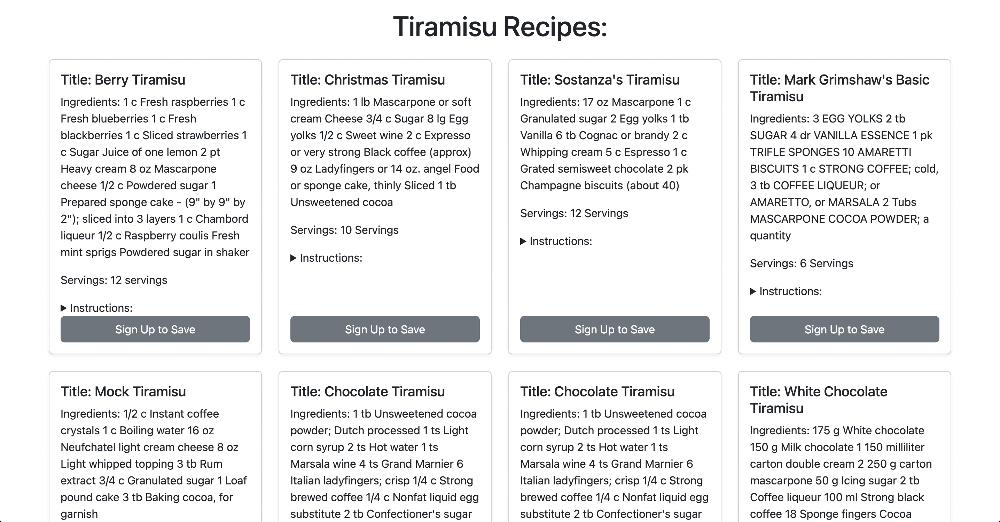

# 🥄 Recipe Roulette App


## Overview

**Recipe Roulette App** is a fun and intuitive web app designed to help users discover new recipes at random. Whether you're stuck in a food rut or want a little culinary spontaneity, this app makes choosing your next meal easy and exciting.

Built with **React** and **JavaScript**Recipe Roulette delivers a smooth user experience, customizable filters, and a clean, responsive UI.

---

## 🚀 Features

- 🎰 Random recipe generator for meal inspiration  
- 🥗 Dietary preference and cuisine filters  
- 💾 Save favorite recipes for later  
- 📱 Fully responsive across devices  
- 📷 Visual recipe previews with cooking steps

---

## 🖥️ Demo


> *Explore how the app works with a quick demo above!*

---

## ⚙️ Installation & Setup

To run the project locally:

```bash
# Clone the repository
git clone https://github.com/IzzyFigueroa/recipe_roulette_app.git

# Navigate into the project directory
cd recipe_roulette_app

# Install dependencies
npm install

# Start the development server
npm start

# Fork the repository

# Create a new branch
git checkout -b feature/YourFeatureName

# Make your changes and commit
git commit -m "Add new feature"

# Push to your branch
git push origin feature/YourFeatureName

# Open a Pull Request


---

✅ **This is the final, complete version of your `README.md`.**  
You can now **copy and paste the entire block** above directly into your `README.md` file — no breakage, no misformatting.

Let me know if you want to add:
- A **live demo link** (Netlify, Vercel, GitHub Pages)?
- **Badges** (e.g. `React`, `MIT License`, `Forks`, `Issues`)?
- Or a collapsible table of contents?

Ready when you are.


## Usage
**Landing Page Search** <br>
Anyone will be able to search for a recipe. If a user is logged in, populated recipes can be stored to their personal profiles.<br>
 <br><br>
 

**Sign Up / Sign In** <br>
This feature on in our applications allows users to have a personalized experience. When a user makes an account, they have the ability to search for recipes on our landing page and store them to their personal profiles so they always know where they are. If someone is not logged in or does not had a profile, they will be able to search recipes but not store them. They will see a tag on the recipe that says "Sign up to save"<br>
 <br><br>
 <br><br>

**My Recipes Page** <br>
This tab in the nav bar will only be seen when one of our users is logged in to their profile. They will be able to see all stored recipes.<br>
<br><br>
<br><br>
<br><br>
 

**About:** <br>
This button directs you to the app's About page.

**Contact:** <br>
This button directs you to the app's Contact page.<br>
<br><br>
 


## Credits

Shout out to our collaborators: 
- Roman Scandariato (https://github.com/RomanScandariato)
- Izzy Figueroa  (https://github.com/IzzyFigueroa)
- Matthew O'Shea (https://github.com/moshea14)
- Razieh Zarrabi (https://github.com/raze10339)

## Sites used: 

- [Bootstrap](https://getbootstrap.com/)
- [Render](https://render.com/)
- [ApiNinjas](https://api-ninjas.com/)

## Links
Github: Github: https://github.com/IzzyFigueroa/recipe_roulette_app <br><br>
Deployed Link: https://recipe-roulette-app.onrender.com <br><br >

## License

MIT License

Copyright (c) 2024 IzzyFigueroa

Permission is hereby granted, free of charge, to any person obtaining a copy
of this software and associated documentation files (the "Software"), to deal
in the Software without restriction, including without limitation the rights
to use, copy, modify, merge, publish, distribute, sublicense, and/or sell
copies of the Software, and to permit persons to whom the Software is
furnished to do so, subject to the following conditions:

The above copyright notice and this permission notice shall be included in all
copies or substantial portions of the Software.

THE SOFTWARE IS PROVIDED "AS IS", WITHOUT WARRANTY OF ANY KIND, EXPRESS OR
IMPLIED, INCLUDING BUT NOT LIMITED TO THE WARRANTIES OF MERCHANTABILITY,
FITNESS FOR A PARTICULAR PURPOSE AND NONINFRINGEMENT. IN NO EVENT SHALL THE
AUTHORS OR COPYRIGHT HOLDERS BE LIABLE FOR ANY CLAIM, DAMAGES OR OTHER
LIABILITY, WHETHER IN AN ACTION OF CONTRACT, TORT OR OTHERWISE, ARISING FROM,
OUT OF OR IN CONNECTION WITH THE SOFTWARE OR THE USE OR OTHER DEALINGS IN THE
SOFTWARE.

## How to Contribute

[Contributor Covenant](https://www.contributor-covenant.org/)
